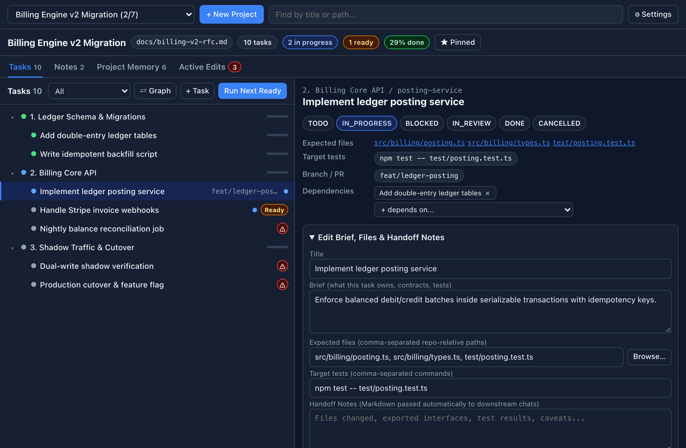
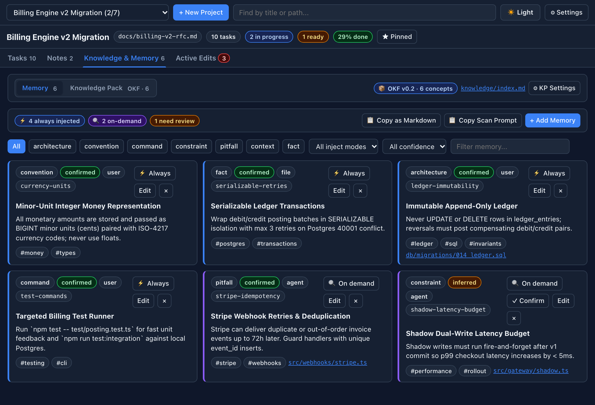
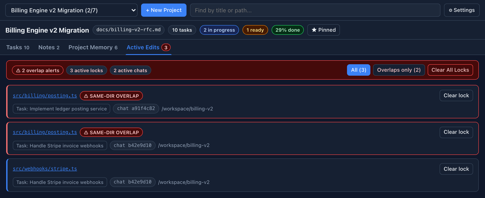

# Work Plan (`work-plan`)

A zero-ops, fully local **Antigravity** plugin for a single developer managing large, multi-day engineering projects across sequential or concurrent chats — with **no backend servers**, **no external databases**, and **no runtime dependencies**.

> **Why Work Plan?**
> - **Large Project Management with Knowledge & Memory Organization:** Break complex codebases into persistent dependency-tracked task trees (up to 500 tasks, depth 8) paired with structured **Project Memory** and portable **Knowledge Packs** (**OKF** bundles & single **Markdown** files).
> - **Empirical ~60% Token Savings & 2–3× Time Savings:** Eliminates repetitive context re-explaining and redundant repo re-scans across sessions via SHA-deduped `[WORK PLAN]` turn briefs, progressive-disclosure Knowledge Packs, structured task handoffs, and safe parallel multi-chat execution with live file-edit guards.

| Capability | Impact |
| :--- | :--- |
| **Large Project Management + Knowledge & Memory** | Keep multi-day specs, task DAGs, durable memories, and OKF/Markdown Knowledge Packs organized in one local SQLite WAL store. |
| **~60% Empirical Token Savings** | Injects only the focused task brief, upstream handoffs, file-matched memories, and progressive-disclosure KP summaries (SHA-256 deduped per turn). |
| **2–3× Empirical Time Savings** | Launch ready tasks in parallel chats with one click while automatic same-folder/worktree edit guards prevent silent overwrites. |

## Architecture


## Screenshots

### Task Tree & Inspector



### Interactive Dependency Graph


### Knowledge & Memory — Memory



### Knowledge & Memory — Knowledge Pack (OKF & Single Markdown)


### Live Active-Edits Guard



## Features

- **Persistent Multi-Session Task Tree & Dependency DAG**: Hierarchical tasks (up to depth 8, 500 tasks/project) with automatic parent status roll-up, cycle/paradox prevention via dual-node Kahn topological validation, and `Ready` vs. `Waiting` filtering.
- **Structured Task-to-Task Handoffs**: Record concise `handoff_notes` when completing a task; downstream chats receive them automatically via `task_start` and SHA-deduped `PreInvocation` turn briefs.
- **Automatic Live-Edit Guard**: Zero-ceremony `PreToolUse` + `PostToolUse` + `Stop` lifecycle hooks prevent silent same-folder overwrites (`force_ask`) across parallel Antigravity chats and warn on shared lockfiles/schemas across Git worktrees (`ask`), clearing locks the instant a turn finishes.
- **Project-Scoped Working Notes**: Store `decision`, `gotcha`, `spec`, and `note` entries alongside the project; pin critical invariants (`pinned: true`) into turn briefs.
- **Knowledge & Memory (`Knowledge & Memory` tab: Memory + Knowledge Pack)**: Combines durable, categorized cross-session **Memory** cards with a **Knowledge Pack (KP)** setting supporting both **OKF (Open Knowledge Format)** bundles (`index.md` + frontmatter concept files) and **single Markdown files** (`.md`), with automatic `[WORK PLAN]` turn-brief injection and 1-click import/export.
- **Interactive Dual-Mode Aux Pane UI (`sidecars/work_plan/` + `ui://work-plan/app.html`)**: Ships both an **Antigravity Sidecar Aux Pane** (`sidecars/work_plan/sidecar.json` → `SIDECAR_UI_ENTRYPOINT_AUX_PANE`) for zero-flag out-of-the-box side pane support and a single-file **SEP-1865 MCP App** (`ui://work-plan/app.html`) sharing the same local SQLite WAL store. Features a responsive master-detail Task Tree + Inspector, interactive left-to-right SVG Dependency Graph with hover tooltips, Notes manager, Knowledge & Memory tab, Active Edits tab, built-in **Light / Dark theme toggle**, and one-click **Run in New Chat** / **Run Next Ready**.

## Knowledge & Memory

The **Knowledge & Memory** tab includes a **`Memory` | `Knowledge Pack`** sub-switch and a persistent Knowledge Pack status bar:

- **Memory**: Store durable, categorized project knowledge (`architecture`, `convention`, `command`, `constraint`, `pitfall`, `context`, `fact`) with idempotent `key` upserts, `always` / file-matched `on_demand` / `disabled` injection modes, confidence tracking (`confirmed`, `inferred`, `stale`), 1-click Markdown export, and agent repo scanning.
- **Knowledge Pack (KP)**: Link a portable, git-native knowledge source on disk via **Browse Folder…** or **Browse .md…**:
  - **OKF (Open Knowledge Format) Bundle**: Point to an OKF directory or its root `index.md` (with `okf_version` frontmatter and Markdown links to concept `.md` files carrying YAML frontmatter `type`, `title`, `description`, `resource`, `tags`, `files`).
  - **Single Markdown File**: Point to any standalone `.md` file (e.g., `KNOWLEDGE.md`, `AGENTS.md`, `ARCHITECTURE.md`) to parse its headings and sections.
  - **Auto-Injection & 1-Click Sync**: Active KPs automatically inject progressive-disclosure summaries (prioritizing concepts/sections matching the bound task's files) into `[WORK PLAN]` turn briefs. Use **⬇ Import KP to Memory** (or per-card **+ To Memory**) to pull items into Memory, or **⬆ Export Memory as OKF** / **⬆ Export Memory as .md** to write your Memory cards out to disk as a standards-compliant OKF v0.2 bundle (`index.md`, `<category>/<slug>.md`, `log.md`) or a single Markdown file.

## Before vs. After (Why ~60% Token Savings & 2–3× Speed)

Managing a large codebase across multiple AI coding agent chats usually breaks down because every new conversation starts cold:

| Workflow Pain Point | Without Work Plan | With Work Plan |
| :--- | :--- | :--- |
| **Starting a new chat on a large codebase** | Re-paste architecture docs, re-read 5–10 files, and re-explain project conventions every session. | SHA-256-deduped `[WORK PLAN]` brief injects only the bound task, upstream `handoff_notes`, file-matched memories, and progressive-disclosure OKF / Markdown Knowledge Pack summaries. |
| **Multi-day task tracking & dependencies** | Lost in long chat scrollback or stale TODO lists; hard to tell what is blocked vs. ready next. | Persistent SQLite task tree + DAG (`Ready` / `Waiting` badges, interactive SVG graph, automatic parent roll-up). |
| **Running parallel AI coding sessions** | Concurrent chats silently overwrite the same files or clash on `package.json` / schemas across worktrees. | Automatic `PreToolUse` / `PostToolUse` / `Stop` live-edit guards catch same-folder (`force_ask`) and cross-worktree (`ask`) collisions in real time, letting you safely run 2–3 tasks in parallel. |

## Installation (Antigravity)

Clone this repository directly into Antigravity's global plugins folder (no `npm install` or build step required for end users because `ui/app.html` is pre-bundled):

```bash
git clone https://github.com/minyaozhu/work-plan.git ~/.gemini/config/plugins/work-plan
```

Once installed:
- Open **Work Plan** from the conversation side pane **`+` menu**, or ask the agent `"Open Work Plan"` to receive a one-click `[Work Plan](sidecar://work-plan/work_plan/)` pill.
- If the plugin was already loaded before updating, toggle **work-plan** off and back on in Customizations (or restart Antigravity) to reload the aux pane.

### Try It in 10 Seconds (Examples & Local Browser Preview)

This repository ships ready-to-use samples in [`examples/`](examples/):
- [`examples/PLAN.md`](examples/PLAN.md) — seed a multi-phase project immediately via **+ New Project → Markdown plan**.
- [`examples/okf-knowledge-pack/`](examples/okf-knowledge-pack/) — link a standards-compliant **OKF v0.2** bundle in **Knowledge & Memory → Knowledge Pack**.
- Want to preview the UI in any browser without Antigravity? Run:

```bash
npm run start:sidecar
# open http://127.0.0.1:8765
```

## Requirements

- **Node.js `>= 22.5`** (for built-in `node:sqlite` WAL storage), or Antigravity's bundled `agy-node` fallback (`bin/run.mjs` detects and re-execs automatically).
- Optional: `git` (for canonical repo/worktree normalization and branch metadata) and `gh` CLI (for seeding from GitHub issue URLs).

## MCP Tools

- **Agent tools**: `project_list`, `project_create`, `project_get`, `task_plan`, `task_start`, `task_update`, `note_save`, `note_list`, `memory_save`, `memory_list`, `memory_delete`
- **UI entrypoints**: `open_work_plan` (`aux_pane` and `global` MCP App views) + `sidecars/work_plan/` (`SIDECAR_UI_ENTRYPOINT_AUX_PANE` at `/`)
- **App-only UI tools** (`visibility: ["app"]`): `ui_get_state`, `ui_select_project`, `ui_bind_conversation`, `ui_create_project`, `ui_update_project`, `ui_archive_project`, `ui_delete_project`, `ui_create_task`, `ui_update_task`, `ui_move_task`, `ui_delete_task`, `ui_set_dep`, `ui_save_note`, `ui_delete_note`, `ui_save_memory`, `ui_delete_memory`, `ui_clear_active_edit`, `ui_browse_dir`

## Lifecycle Hooks (`hooks.json`)

- `PreToolUse` (`pre-edit`): Fast-exits outside workspace / `os.tmpdir()` / `~/.gemini/`; checks active sibling edits (`force_ask` on same-folder collision, `ask` on cross-worktree shared manifests/schemas).
- `PostToolUse` (`post-edit`, `post-mcp`, `post-command`): Records approved edit locks, binds conversations to tasks after `task_start`/`project_create`, and opportunistically records `branch_name` / `pr_url`.
- `PreInvocation` (`pre-invocation`): Injects SHA-256-deduped `[WORK PLAN]` brief (<40 ms p95).
- `Stop` (`stop`): Immediately clears `ActiveEdits` locks held by the finished conversation.

## Development & Verification

```bash
npm install          # installs devDependencies only (esbuild + @modelcontextprotocol/ext-apps)
npm run build:ui     # bundles ui/src/* -> self-contained ui/app.html
npm run start:sidecar # optional standalone preview at http://127.0.0.1:8765
npm test             # runs core, MCP/hooks E2E, sidecar, and UI test suites
```

## License

[MIT](LICENSE)
